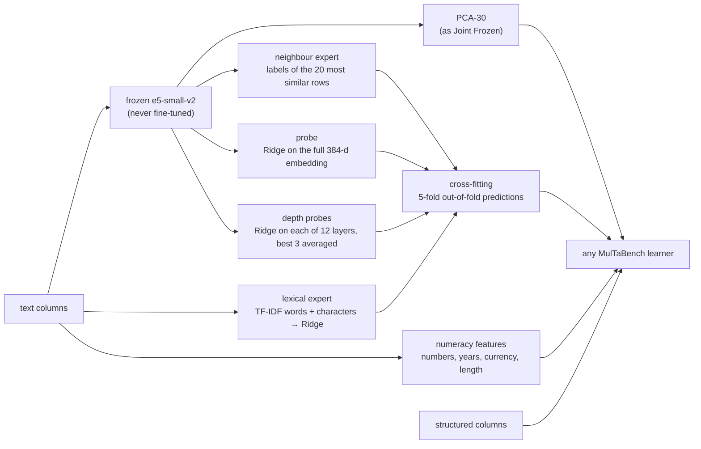

# Cross-fitted Text Experts: target-aware text features for tabular learning, without fine-tuning

An extension of [MulTaBench](https://github.com/alanarazi7/MulTaBench), the benchmark for tables with free-text
columns ([arXiv:2605.10616](https://arxiv.org/abs/2605.10616)). The benchmark's strongest text pipeline, **Joint TAR**,
fine-tunes the text encoder on each task. This repository presents a method that makes the text features target-aware
**without fine-tuning anything**. A frozen encoder is read by a few cheap models that predict the target ("experts"),
each trained so that it never sees the label of the row it describes. With all five MulTaBench learners, the method
scores higher than Joint TAR with the same learner.

## Results

The official MulTaBench evaluation on its 20 text-tabular datasets, 5 folds each (AUROC for classification, R² for
regression), compared with the published Joint TAR score of the **same learner, dataset and fold**:

| Learner | Datasets | Joint TAR | Ours | Mean gain [95% CI] | Datasets won | Wilcoxon p |
|---|---:|---:|---:|---:|---:|---:|
| CatBoost | 20 | 0.811 | 0.828 | +0.016 [0.008, 0.024] | 14 | 0.002 |
| LightGBM | 20 | 0.798 | 0.817 | +0.019 [0.008, 0.031] | 14 | 0.006 |
| TabM | 20 | 0.819 | 0.836 | +0.016 [0.008, 0.024] | 16 | 0.0007 |
| TabPFN-v2 | 18 | 0.783 | 0.812 | +0.029 [0.013, 0.049] | 14 | 0.004 |
| TabPFN-2.5 | 18 | 0.807 | 0.827 | +0.020 [0.010, 0.031] | 15 | 0.001 |


Left: mean scores (the axis starts at 0.70 and averages AUROC with R², as the benchmark's summaries do). Right: the
gain over Joint TAR with its 95% interval, the honest scale.

- **Significant with every learner** (two-sided Wilcoxon signed-rank test over datasets, each test specified before
  its run). With a Holm correction over all 17 tests run during the project, 4 of 5 remain significant (LightGBM: 0.061).
- **Broad:** 76% of the 480 individual (learner, dataset, fold) runs beat Joint TAR; 14 of the 20 datasets are won
  with at least 4 of the 5 learners.
- **Where fine-tuning still wins:** Jigsaw Toxicity, the dataset on which fine-tuning itself gains the most
  (+0.117 over the frozen encoder). On 36 further text datasets never used in development the gain is smaller
  (median +0.003, 24 of 36 won).
- TabPFN has no published baseline for 2 of the 20 datasets (Spotify Genres, Wine Review).

Full analysis, with every comparison and chart: [**notebook 02**](notebooks/02_results.ipynb). Raw scores:
[`results/`](results/).

## Background

In a text-tabular dataset, some columns are numbers and categories and at least one is free text: a product
description, a review, a job posting. MulTaBench evaluates such data with one pipeline: each text column is embedded
with the e5-small-v2 encoder, the 384-dimensional embedding is reduced to 30 dimensions with PCA, and a tabular learner
(CatBoost, LightGBM, TabM, TabPFN-v2 or TabPFN-2.5) predicts from these and the structured columns. Two versions:

- **Joint Frozen:** e5 as published.
- **Joint TAR** (target-aware representations): e5's top layers are first fine-tuned with LoRA to predict the target
  from the text, then used for the embeddings. It is the stronger baseline.

## The problem with fine-tuning the encoder

Each one measured on the benchmark, while studying it or while developing the method:

1. **Over-trust.** The encoder is fine-tuned on the training rows and then embeds those same rows, so their text
   features look better than they will on new rows: TAR's prediction head scores +0.031 higher on its own training
   rows than on test rows (16 of 18 runs, p = 0.0002). The learner trusts them too much.
2. **PCA does not look at the target.** 384 → 30 dimensions keeps the directions in which the texts vary most, not
   necessarily the ones that predict the target. This is a motivation, not a measured cause of Joint TAR's shortfall (the
   MulTaBench paper's Figure 6 finds Joint TAR ahead of Joint Frozen at 15, 30 and 60 components alike); a probe on the full 384
   dimensions adds +0.0035 on top of the experts (CatBoost, 20 datasets).
3. **Only the last layer is read.** The layer from which a linear probe best predicts the target varies from layer 2 to
   layer 12, and in 14 of the 20 datasets it is an inner layer, not the final one (out-of-fold scores on training rows,
   20 datasets × 5 folds). The largest gain is Book Readability at layer 3, where surface form matters.
4. **Exact words and numbers get blurred.** A sentence embedding smooths over the specific tokens ("Riesling",
   "$45", "2015") that often carry the signal: adding only the cross-fitted lexical expert (TF-IDF + Ridge) to the
   standard frozen features already matches Joint TAR (±0.000).
5. **A GPU for every run.** Upstream fine-tunes the encoder again inside every learner's run: for every dataset,
   fold and learner.

## The method



The learner receives everything Joint Frozen gives it, plus a few columns that are **predictions of the target from
the text**, each from a different view: the exact words (lexical expert), similar rows (neighbour expert), the whole
final-layer embedding (probe) and the best inner layers (depth probes). Each answers one problem above: cross-fitting
(1), the probe on all 384 dimensions (2), the depth probes (3), the lexical expert and numeracy features (4), and no
fine-tuning, so no GPU (5).

**Cross-fitting** is what makes this work. The training rows are split into 5 parts; each part's expert predictions
come from experts trained on the other 4, so no training row's feature was computed with its own label, exactly as
for a test row. Test rows get predictions from experts trained on all training rows. The same lexical expert without cross-fitting
(trained on all training rows, then used on them) scores 0.034 lower, well below Joint TAR.

Everything that uses labels is fit on training rows only, and nothing is fine-tuned: the encoder is the public
`intfloat/e5-small-v2`, and no model weights are needed beyond it. Details, every option and runtimes:
[**method README**](multabench/ours/README.md).

## Quickstart

```bash
uv sync --frozen            # Python 3.11 environment, pinned by uv.lock
cp .env.example .env        # add your Kaggle credentials (dataset downloads)

# train on a MulTaBench dataset and fold (the benchmark's own split), or on any CSV with a target column
.venv/bin/python scripts/train.py --dataset MUL_TEXT_PRODUCT_SENTIMENT --fold 0 --out_dir models/ps
.venv/bin/python scripts/train.py --csv my_table.csv --target price --out_dir models/my_table --learner lgbm

# predict new rows with the saved model folder
.venv/bin/python scripts/predict.py --model_dir models/ps --csv new_rows.csv --out predictions.csv
```

Learner choice, API keys (TabPFN-2.5 needs one), measured runtimes and the benchmark runner: [method README](multabench/ours/README.md).

## Is this the official benchmark?

- The upstream code is included unmodified, at tag [`paper_version`](https://github.com/alanarazi7/MulTaBench/tree/paper_version).
  For the 20 text datasets its splits, metrics, preprocessing and published baseline scores are identical to upstream
  `master` of 26 July 2026 (commits `599bd6a` and `c955466`); `git diff` over those paths is empty.
- Our code plugs in at the single text-encoder step of upstream's learners
  ([`learners.py`](multabench/ours/learners.py)); the learners, their settings, the splits and the metric functions
  are upstream's own.
- Our re-implementation of Joint TAR reproduces the published scores (mean difference −0.002).
- Every headline number is recomputed from the raw result files by a script that uses no project code
  ([`check_recompute.py`](scripts/check_recompute.py)), and with shuffled training labels the method falls to chance
  ([`check_label_shuffle.py`](scripts/check_label_shuffle.py)).

## Notebooks

| # | Notebook | What it answers |
|---|---|---|
| 01 | [Benchmark study](notebooks/01_benchmark_study.ipynb) | What the published baselines show before building anything: how much fine-tuning adds per dataset and learner, and how large the fold noise is |
| 02 | [Results](notebooks/02_results.ipynb) | Every comparison with the baselines: per learner, per dataset, consistency, noise, task type, class imbalance, ablations, the 36 further datasets, trust checks |
| – | [Colab runner](notebooks/colab_run.ipynb) | Runs a jobs file of experiments on a Colab GPU, results to Google Drive |

## How we got here

The method was reached in steps, each tested on development splits of the training rows and then, once specified in
advance, on the full benchmark. Fine-tuning variants that put the structured columns into the encoder's input did not
beat Joint TAR. Cross-fitting the fine-tuned head fixed the over-trust but cost 22 GPU-hours and was no better, which
raised the question of whether the target-awareness needs fine-tuning at all. Cheap frozen experts matched Joint TAR;
a probe on the full embedding, then probes on the inner layers, took it clearly past. Every stage, with its numbers:
[`archive/README.md`](archive/README.md).

## Limitations

- **Toxicity-like targets.** On Jigsaw Toxicity fine-tuning keeps a clear edge with every learner; what a frozen
  encoder cannot represent, no read-out of it can recover.
- **Smaller gains on new data.** On 36 further datasets the gain is positive but small, and not significant after
  correcting for the number of tests.
- **The 20 datasets were seen during development.** Ideas were compared on splits of the training rows only and each
  final claim was specified before its run, but the method was chosen on these datasets.
- **Not faster.** Building our features on a CPU takes about 2.7 minutes per job, against 1.3 minutes for an
  optimised GPU fine-tuning of Joint TAR on the same machine; the method saves the GPU, not time.
- **One seed** (42) per run, as in the published baselines.

## Repository layout

```
multabench/ours/          the method (cte.py, p7.py, depth.py) and its plumbing; README with every detail
multabench/ours/archive/  code of earlier versions, kept runnable
scripts/                  train / predict, the benchmark runner, report and check scripts
results/                  final scores per fold, per dataset and per learner; figures
reports/                  the pre-registered analysis of each final claim (p14, p15, p16), checks, tables
notebooks/                01 benchmark study, 02 results, the Colab runner
jobs/                     the jobs files of the final runs
paper/                    the paper (LaTeX)
archive/                  development history: lab notebook, earlier reports, jobs, scripts
tests/                    unit and end-to-end tests
multabench/ (the rest), benchmark.py   upstream MulTaBench, unmodified
```

Built on [MulTaBench](https://github.com/alanarazi7/MulTaBench) by Arazi et al.; all benchmark, preprocessing and
evaluation code is theirs.
